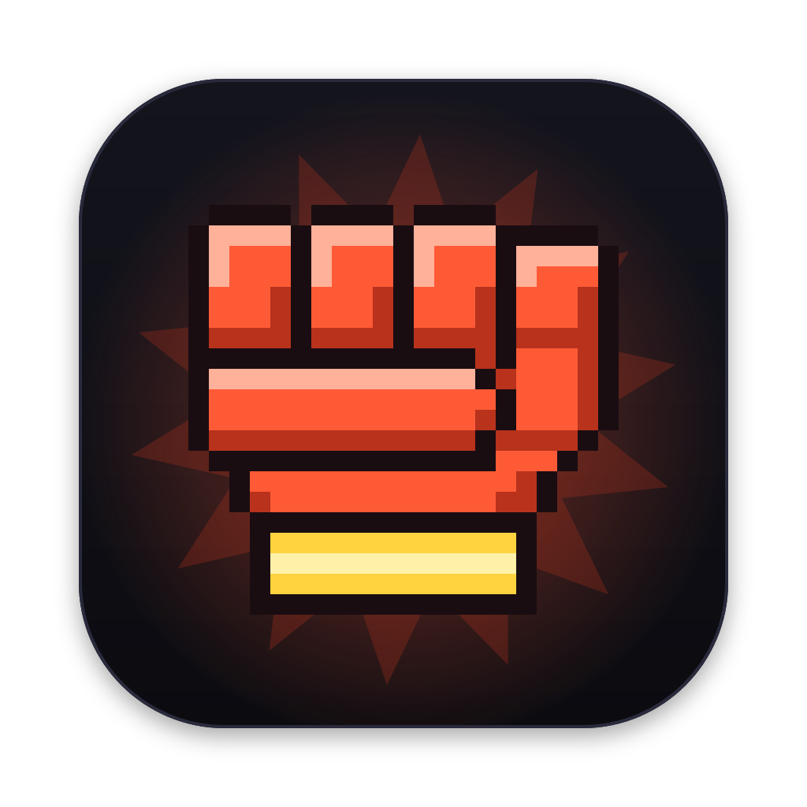
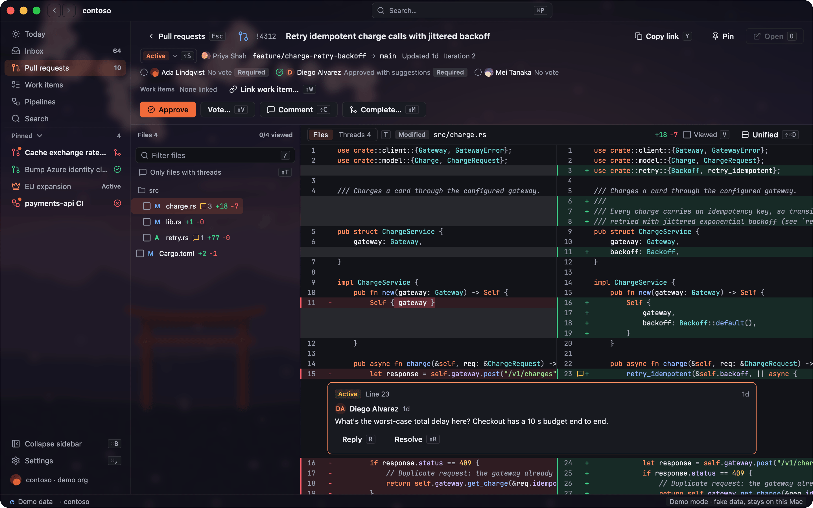
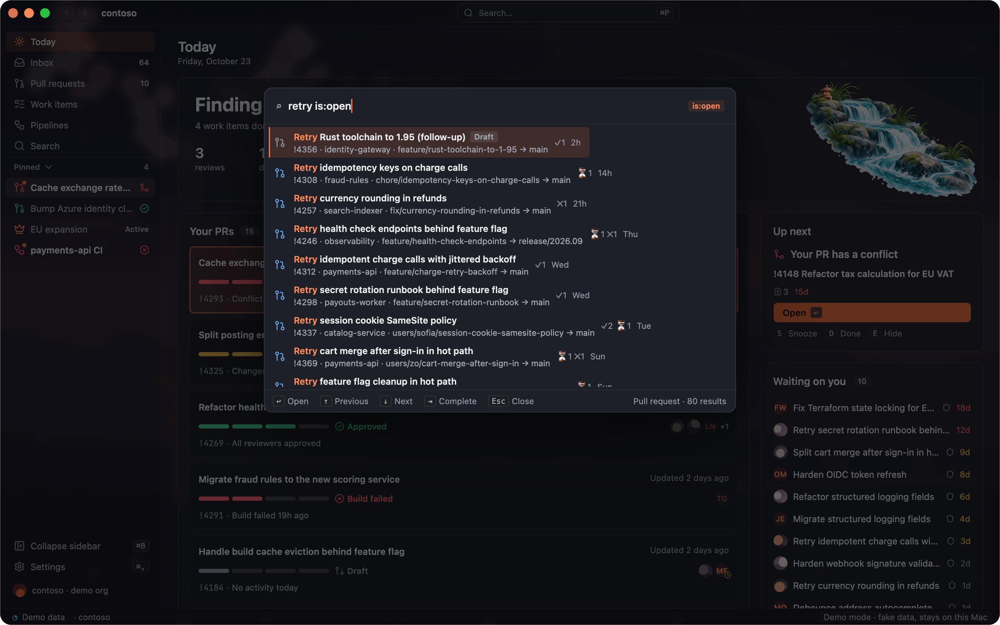
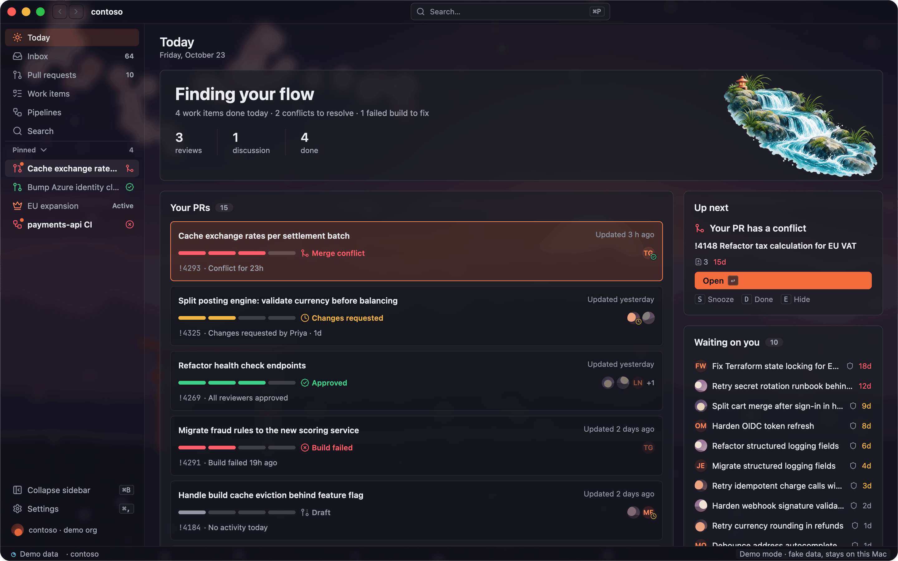
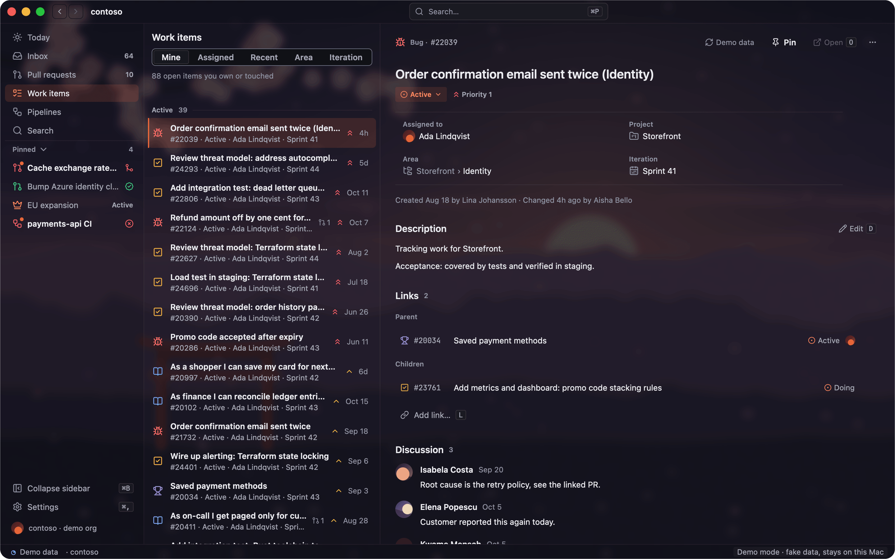
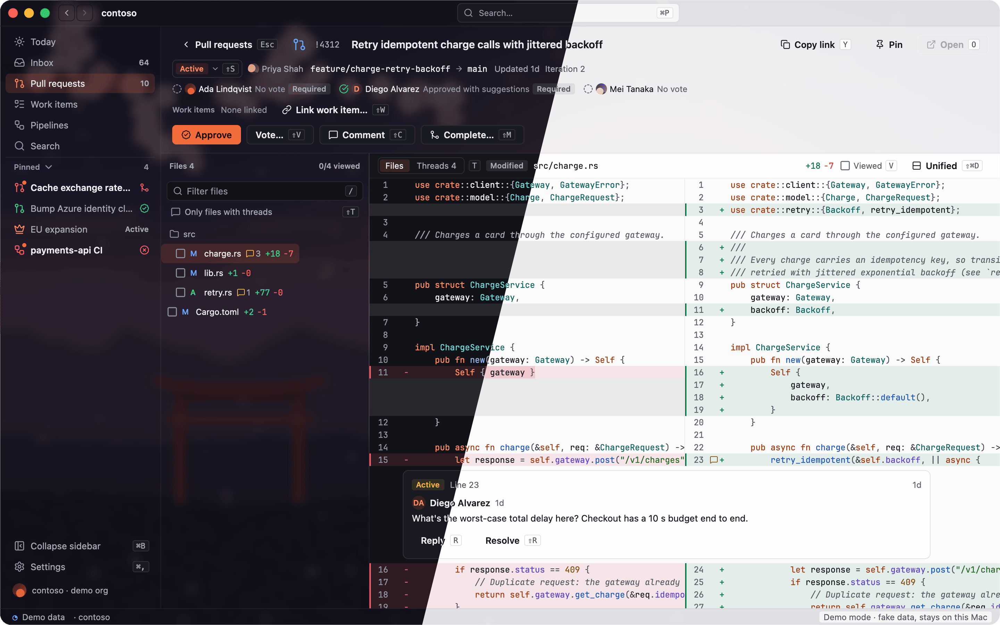

<p align="center">
  
</p>

<h1 align="center">adoken</h1>

<p align="center">
  <b>Azure DevOps, with a punch.</b><br>
  A native, local-first desktop client for Azure DevOps. Pull requests, work items, pipelines and people live on your
  machine, so search, review and triage move at the speed you think.
</p>

<p align="center">
  <a href="https://github.com/benzara-tahar/adoken/releases/latest"></a>
  <a href="https://github.com/benzara-tahar/adoken/actions/workflows/ci.yml"></a>
  <a href="LICENSE"></a>
  
  
  
  <a href="https://x.com/BenzyPrime"></a>
</p>

<p align="center">
  <a href="https://github.com/benzara-tahar/adoken/releases/latest/download/adoken-macos-arm64.dmg"><b>Download for macOS</b></a>
  ·
  <a href="https://adoken.dev">Website</a>
  ·
  <a href="CHANGELOG.md">Changelog</a>
  ·
  <a href="docs/roadmap.md">Roadmap</a>
  ·
  <a href="CONTRIBUTING.md">Contributing</a>
</p>

<p align="center">
  
</p>

ADO + 拳 (*ken*, "fist"). The Azure DevOps web UI makes you wait on spinners and floods you with email. adoken
syncs what matters into a local SQLite store, so every view opens in a frame and ⌘P finds anything in under 50 ms,
and it turns the notification flood into one quiet inbox. No adoken server sits between you and Azure DevOps.

## Features

<table>
  <tr>
    <td width="50%" valign="top">
      
      <p><b>⌘P for everything.</b> Pull requests, work items, runs, people, repos and commands from one local
      index. Filters like <code>author:@me</code>, <code>state:</code>, <code>is:open</code> and
      <code>updated:&lt;7d</code>; paste an Azure DevOps link to jump straight to it.</p>
    </td>
    <td width="50%" valign="top">
      
      <p><b>Today and smart nudges.</b> Your day at a glance: your PRs with their review state, the next thing
      to unblock, and what's waiting on you. Nudges for stale reviews, failing builds and conflicts, at most
      three a day.</p>
    </td>
  </tr>
  <tr>
    <td width="50%" valign="top">
      
      <p><b>Work items without the browser.</b> Change state, assignee, area, iteration and description in
      place, link items and comment with @mentions. Works with any process template: Agile, Scrum, CMMI or your
      own custom states.</p>
    </td>
    <td width="50%" valign="top">
      
      <p><b>Make it yours.</b> 33 built-in theme variants, custom backgrounds, optional sounds, and Ken, an
      opt-in arcade layer for review streaks. Everything respects Reduce Motion.</p>
    </td>
  </tr>
</table>

Also in the box: a quiet **inbox** (one row per item, priorities, snooze, mute, quiet hours, macOS banners),
**pins** for up to 20 items, **back/forward** history, a global shortcut, and an **activity drawer** that logs every
request adoken sends to Azure DevOps.

## Install

1. Download [`adoken-macos-arm64.dmg`](https://github.com/benzara-tahar/adoken/releases/latest/download/adoken-macos-arm64.dmg)
   (macOS 12+ on Apple silicon), open it and drag adoken onto Applications.
2. This early preview isn't notarized yet, so macOS blocks the first launch. Open adoken once, dismiss the warning,
   then click **Open Anyway** in System Settings → Privacy & Security. Or run
   `xattr -dr com.apple.quarantine /Applications/adoken.app`.
3. Connect your organization with the Azure CLI (`az login`) or a pasted Personal Access Token. The token is kept in
   the macOS Keychain and never written to disk or logs.

Just looking? `open --env ADOKEN_DEMO=1 /Applications/adoken.app` opens a fictional Contoso org with no sign-in and
no network.

Supported: Azure DevOps Services (`dev.azure.com` and `*.visualstudio.com`), one organization per install. Azure
DevOps Server (on-premises) and Windows are on the [roadmap](docs/roadmap.md).

# Development

Product rules, layout and workflow: [`AGENTS.md`](AGENTS.md). Roadmap: [`docs/roadmap.md`](docs/roadmap.md).

## Desktop app vs website

| | Desktop app | Website |
| :-- | :-- | :-- |
| What | adoken itself: the Azure DevOps client | adoken.dev, the product page and download link |
| Where | `crates/` (Rust workspace, binary `adoken`) | `public/` (Astro, static) |
| Runs on | macOS 12+ on Apple silicon; Windows at v0.3 | Cloudflare (Workers or Pages) |
| Docs | this file, [`docs/release.md`](docs/release.md) | [`public/README.md`](public/README.md) |

There is no browser version of the app. The product visuals on the website are HTML/CSS mocks on fictional data,
not the app running in a page.

## Prerequisites (macOS)

- Rust via [rustup](https://rustup.rs). `rust-toolchain.toml` pins stable; the workspace needs 1.95+.
- Xcode Command Line Tools (`xcode-select --install`). Full Xcode isn't needed: Metal shaders compile at startup.
- For the website only: [Bun](https://bun.sh).

## Run the app

All commands run from the repo root.

### Dev mode: `cargo run`

```sh
cargo run -p adoken                        # debug build, your real org
ADOKEN_DEMO=1 cargo run -p adoken          # demo mode (below)
cargo run -p adoken --release              # optimized; use this to judge speed
```

Fastest edit-run loop, logs in the terminal. A bare binary has no bundle id, so macOS notification banners are
skipped (the inbox shows in-app toasts instead) and Settings shows the permission as "Unavailable". The dock badge
still works. Use the bundled app to test banners.

### Bundled app: `scripts/bundle.sh`

```sh
scripts/bundle.sh               # debug build → target/bundle/adoken.app
scripts/bundle.sh --release     # optimized build (thin LTO, stripped)
scripts/bundle.sh --no-build    # re-bundle the last build without compiling
scripts/bundle.sh --run         # build, quit any running adoken, open the new one
scripts/bundle.sh --adhoc       # ad hoc signature (CI does this automatically)
```

Then launch it:

```sh
open target/bundle/adoken.app                        # as from Finder (or double-click it)
open --env ADOKEN_DEMO=1 target/bundle/adoken.app    # demo mode
target/bundle/adoken.app/Contents/MacOS/adoken       # bundled, logs in the terminal
```

The script signs the bundle with a local "adoken dev" certificate (`scripts/dev-signing.sh`, created on first use;
it asks for your macOS password once, so run it from your own terminal the first time). A stable signature keeps
the Keychain's "Always Allow" for the PAT across rebuilds; with an ad hoc signature macOS asks again after every
build. Details: [`docs/release.md`](docs/release.md).

### Real mode vs demo mode

| | Real (default) | Demo (`ADOKEN_DEMO=1`) |
| :-- | :-- | :-- |
| First launch | Onboarding: connect your org with a PAT (via `az` or pasted) | Skips onboarding, opens straight on the fictional Contoso org |
| Data | Synced from Azure DevOps into `~/Library/Application Support/dev.adoken/orgs/<org>/adoken.sqlite` | Seeded fake data in `$TMPDIR/adoken-demo` (override with `ADOKEN_DEMO_DIR=<dir>`) |
| Secrets | PAT in the macOS Keychain | No Keychain, no network |
| Actions | Everything | Actions that would talk to Azure DevOps are hidden |

Demo mode never touches your real data directory or Keychain, so it's safe for screenshots, videos and demos.

### Launch switches

| Variable | Effect |
| :-- | :-- |
| `ADOKEN_DEMO=1` | Demo mode (see above). Also accepts `true`, `yes`. |
| `ADOKEN_DEMO_DIR=<dir>` | Where demo mode seeds its store. |
| `ADOKEN_ONBOARDING=1` | Force onboarding from Welcome (also `welcome`, `connect`, `create_in_browser`). Ignored in demo mode. |
| `ADOKEN_NAV=<section>` | Open on `today`, `inbox`, `prs`, `workitems`, `pipelines` or `search`. |
| `ADOKEN_PALETTE=<query>` | Open with the ⌘P palette showing that query. |
| `ADOKEN_SETTINGS=<tab>` | Open Settings on `general`, `appearance`, `backgrounds`, `sounds`, `notifications`, `nudges`, `sync`, `keyboard`, `ken`, `account` or `about`. |
| `ADOKEN_REDUCE_MOTION=1\|0` | Override the macOS Reduce Motion setting and Settings › General › Motion. |
| `ADOKEN_SYNC_LOG=<file>` | Append every Azure DevOps request as a redacted JSON line (the Network log export format). |

Example: `ADOKEN_DEMO=1 ADOKEN_NAV=prs ADOKEN_PALETTE=login cargo run -p adoken`.

### Start over

Sign out in Settings › Account, then delete `~/Library/Application Support/dev.adoken`. Demo data lives in
`$TMPDIR/adoken-demo` and can be deleted at any time.

## Component gallery, tests, perf

```sh
cargo run -p adoken-gallery                     # every UI component; ⌘T cycles themes
cargo run -p adoken-gallery -- --themes <dir>   # also load *.adoken-theme.toml from <dir>
cargo test --workspace                          # unit, smoke and snapshot tests
UPDATE_SNAPSHOTS=1 cargo test -p adoken-gallery --test snapshots   # rewrite goldens; review the PNG diff
SNAPSHOT_FILTER=<story> cargo test -p adoken-gallery --test snapshots
scripts/perf.sh                                 # cold start, frame time, search latency vs budgets
```

Snapshot goldens live in `crates/gallery/snapshots/`; mismatches are written to `target/snapshot-failures/`.
Every UI component needs a gallery story and a snapshot per built-in theme.

## Distribute

### To testers: `scripts/dmg.sh`

```sh
scripts/dmg.sh              # release bundle → target/bundle/adoken-<version>.dmg
scripts/dmg.sh --no-build   # package the existing target/bundle/adoken.app
```

The dmg opens to `adoken.app` next to an `Applications` link; drag one onto the other. Limits:

- **Gatekeeper blocks the first launch** on any other Mac, because the app has only a local signature. Each
  tester allows it once: open the app, dismiss "Apple could not verify…", then System Settings → Privacy &
  Security → **Open Anyway** (macOS 15+ dropped right-click → Open). Or run
  `xattr -dr com.apple.quarantine /Applications/adoken.app`.
- **Apple silicon only.** The binary is arm64; Intel Macs can't run it.

Only send these builds to people you trust to bypass Gatekeeper.

### Public release

Releases are built by [`.github/workflows/release.yml`](.github/workflows/release.yml). Bump `version` in
`Cargo.toml`, move the `[Unreleased]` notes in `CHANGELOG.md` under the new version, then tag and push:

```sh
git tag v0.0.2 && git push origin v0.0.2
```

The workflow builds the release bundle, packages the dmg and publishes a GitHub Release with that version's
changelog section. `adoken-macos-arm64.dmg` keeps the same name in every release, so
`releases/latest/download/adoken-macos-arm64.dmg` (the adoken.dev download button) always serves the newest build.
Those builds carry an ad hoc signature, so Gatekeeper asks once per Mac (see Install).

Anyone-can-open downloads need an Apple Developer Program membership and a Developer ID Application certificate.
Then: sign with hardened runtime, notarize, staple, package the dmg, and sign + notarize + staple the dmg too.
The full checklist (one-time setup, commands, clean-machine verification, secrets handling) is in
[`docs/release.md`](docs/release.md) under "Distribution". Versioning follows SemVer with Conventional Commits;
changes go in [`CHANGELOG.md`](CHANGELOG.md).

### Website

Build and deploy steps for adoken.dev: [`public/README.md`](public/README.md).

## Contributing

Issues and pull requests are welcome. Read [`CONTRIBUTING.md`](CONTRIBUTING.md) first: features start as a spec in
`docs/specs/`, and every change has to keep adoken fast and quiet. Report security problems privately as described
in [`SECURITY.md`](SECURITY.md). Everyone taking part follows the [code of conduct](CODE_OF_CONDUCT.md).

## License

[MIT](LICENSE). Third-party code, themes, fonts, icons and media keep their own licenses, listed in
[`THIRD_PARTY_NOTICES.md`](THIRD_PARTY_NOTICES.md) and [`assets/manifest.toml`](assets/manifest.toml).
