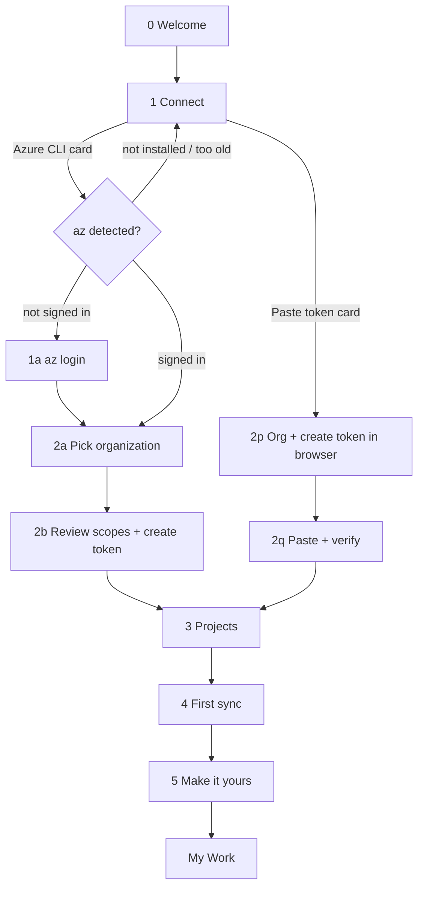

# Onboarding

Status: v0.1. Owner: ux-designer. Behavior/acceptance: `docs/specs/0001-*` (onboarding). Tokens: [tokens.md](tokens.md). Copy rules: [principles.md](principles.md) §5.

Amended 2026-10-01 from the owner's notes (spec 0001 FR-12–FR-20, accepted 2026-10-01): new Welcome screen with the `onboarding-welcome` illustration (§3.0, §6, §7, §9), scope rows with what each permission allows (§4), no expiry reminder and no renew prompts (§3.2b, §3.2q, §10), Settings › Account layout and copy (§10).

Goal: from first launch to a useful My Work view in under 90 seconds, with the token created for the user when az cli is available, and without ever showing the token value.

## 1. Flow



Step indicator (5 dots, top of card): **Connect · Token · Projects · Sync · Make it yours**. Screen 0 has no indicator.

Resume: each completed step is persisted (org, chosen path, project ids, prefs; token goes to the keychain immediately on successful verify). Relaunching mid-onboarding resumes at the first incomplete step with a Back button available.

## 2. Canvas and layout

- Full window, `z.onboarding`. Background: `builtin:ink` (static, `dim 0.2`, no video) unless `[background.views.onboarding]` says otherwise (it can't on first run).
- Card: width 560, min height 420, height animates to content, `radius.xl`, `elevation.3`, `bg.overlay` at 0.96, padding `space.40`. Centered, shifted up 4 % of window height.
- Header row: 5-dot step indicator (dot 6 × 6 `text.disabled`; active = 18 × 6 pill `accent.solid`; done = 6 × 6 `text.secondary`) and a Back link (`‹ Back`, `⌘[`) on the left from step 1 on.
- Content: `type.display` headline, `type.body` `text.secondary` subline (max 2 lines), body, then a footer: primary button right (`size.control.lg`, with `↩` keycap), secondary action left.
- Window min size during onboarding: 720 × 560. Below that the card becomes full-bleed (radius 0).

## 3. Screens

### 0 — Welcome

(amended 2026-10-01, owner notes; accepted 2026-10-01)

```
            ┌──────────────────────────────┐
            │   onboarding-welcome image   │  360 × 240
            └──────────────────────────────┘
                 Welcome to adoken
   Review pull requests, track work items, and
          stay on top of your day.
                  [ Get started ↩ ]
   Works with Azure DevOps Services (dev.azure.com).
```

- **Image:** `onboarding-welcome` (`output/today-redesign-2026-10-01/images/09-onboarding-welcome.png`, 1536 × 1024, transparent; the pixel fist and the "adoken" wordmark, original art drawn from adoken's own app icon). Displayed at 360 × 240 pt, centered at the top of the card content, aspect ratio kept, no tint, no border, the same asset in every theme. It ships as a 720 × 480 px (2×) asset decoded off the UI thread (asset contract C2). The 360 × 240 box is laid out from the first frame, empty until the image is decoded, so nothing moves when it arrives. Decorative for assistive tech (§9).
- **Title:** **Welcome to adoken** (`type.display`, `text.primary`).
- **Description:** "Review pull requests, track work items, and stay on top of your day." (`type.body`, `text.secondary`, max width 420, centered).
- **Primary:** **Get started** `↩` → screen 1 (Connect).
- **Footnote:** "Works with Azure DevOps Services (dev.azure.com)." (`type.small`, `text.tertiary`), so Server users stop here.
- Stack: centered column, gap `space.16`, all text centered. Title, description and button are UI text, never baked into the image.
- The 拳 text emblem and its 4-stroke reveal are gone from this screen: the illustration already carries the fist and the name, and two marks would compete. `assets/brand/emblem-strokes.svg` is no longer needed; `emblem.svg` stays for the Ken fight card (ken.md §5).
- On mount, az detection (§5) starts in the background so step 1 usually renders with results already in.

### 1 — Connect

Headline: **Connect Azure DevOps** · Subline: "adoken needs a personal access token. It can make one for you with the Azure CLI, or you can paste your own."

Two option cards stacked, each 480 × 88, `radius.md`, `elevation.1`, selectable with `↑ ↓` or `1`/`2`, `↩` to continue:

**Card 1 — Use Azure CLI** (badge "Recommended" `accent.wash`/`accent.fg` when az is ready). Right side shows detection state:

| Detection state | Right side of card | Card enabled |
|---|---|---|
| Checking (< 150 ms: nothing; then) | spinner 14 px + "Looking for az…" | no |
| Ready | `circle-check` `status.success.fg` + "az 2.64.0 · signed in as dana@contoso.com" | yes |
| Signed out | `circle-alert` `status.warning.fg` + "az 2.64.0 · not signed in" → continues to 1a | yes |
| Too old | `circle-alert` warning + "az 2.29.1 · needs 2.30.0 or newer" + link "How to update" | no |
| Not installed | `circle-x` `text.tertiary` + "Azure CLI not found" + link "Install Azure CLI" (opens learn.microsoft.com install page) + [Check again] | no |
| Timed out / errored | `circle-alert` + "az didn't respond" + [Check again] + [Details] | no |

When card 1 is disabled, card 2 is preselected. A disabled card is still focusable and its reason is in its accessible label.

**Card 2 — Paste a token.** Right side: "Create one in the browser, paste it here." Always enabled.

### 1a — Sign in to Azure CLI (only if signed out)

Headline: **Sign in with Azure CLI** · Subline: "This opens your browser. adoken never sees your password."
- Primary **Open sign-in** `↩` → runs `az login` (no device code by default; secondary link "Use a device code instead" runs `az login --use-device-code` and shows the code in `type.code_inline` with [Copy]).
- While waiting: spinner + "Waiting for you to finish in the browser…" + [Cancel] (kills the child process). Timeout 5 min → "Sign-in timed out. [Try again]".
- Success: check morph (§6), auto-advance after 400 ms.
- Failure: inline error with az's first stderr line, [Try again], [Paste a token instead].

### 2a — Pick organization (az path)

Headline: **Choose your organization** · Subline: "adoken works with one organization. You can pick projects next."
- Data: org list from the Entra token (§5.3). Loading: 3 skeleton rows.
- List: radio rows (`size.row.default`): org name (`type.body_strong`) + `dev.azure.com/<org>` (`type.small`, `text.tertiary`). Filter input above the list when > 6 orgs (fuzzy). If exactly one org → preselected; if `az devops configure` has a default org → preselected and sorted first with tag "az default".
- Footer secondary: "Not listed? Enter it manually" → inline text field `dev.azure.com/ [ org ]`.
- Empty (no orgs for this account): "No organizations found for dana@contoso.com." + "Signed into the wrong directory? `az login --tenant <id>`" [Copy command] + "Enter it manually".
- Primary: **Continue** `↩`.

### 2b — Review access (az path)

Headline: **Create a token for adoken** · Subline: "adoken will create a personal access token with exactly these permissions. It won't ask for more later." (amended 2026-10-01, owner notes; accepted 2026-10-01)

**Access level** (spec 0001 Q-5; amended 2026-10-01, owner notes; accepted 2026-10-01): Review is the level shown; there is no segmented control. Under the scope list, a link button (`type.small`, `accent.fg`) reads "Need a read-only token instead?"; it switches the list to the Read-only rows and becomes "Use the Review token instead". Subline above the list in `text.tertiary`: Review = "Vote, comment, and edit work items from adoken." · Read-only = "Browse only. Voting, commenting and editing open in the browser." Switching swaps the Code and Work Items rows between their write and read scopes with a 140 ms crossfade of the access chips (reduce motion: instant). Read-only users change level later in Settings › Account › **Change access…**.

Scope list (see §4 for exact rows): each row has icon, scope name as ADO labels it, access level chip, the `vso.*` id in `type.code_inline` `text.tertiary`, and its "What it allows" line. (amended 2026-10-01, owner notes; accepted 2026-10-01) No toggles: adoken creates the whole set of the chosen level (spec 0001 FR-12), so no feature asks for more later.

Below the list:
- **Token name:** read-only preview `adoken · <hostname>`.
- **Expires in:** segmented control `30 days · 90 days · 180 days · 1 year` (default 90; 1 year = 365 days, spec 0001 Q-8). (amended 2026-10-01, owner notes; accepted 2026-10-01) No note under it: adoken doesn't remind about expiry; the date shows in Settings › Account, and a token created here is replaced automatically before it expires (spec 0001 FR-20).
- Privacy line with `lock` icon: "Stored in your macOS Keychain. Never written to disk or logs." (Windows: "Windows Credential Manager".)

Primary: **Create token** `↩`. While creating: button spinner, label "Creating…". Success: check morph on the button, then auto-advance after 400 ms to step 3 (sync of the chosen projects starts only after step 3).

Errors:
- Org policy restricts PAT lifetime (`patLifespanPolicyViolation`) → retry once automatically at 30 days; segmented control snaps to 30 and a notice appears under it: "Your organization limits token lifetime, so adoken used 30 days." If the retry also fails, show the policy error below.
- Org disallows PAT creation (policy) → "Your organization doesn't allow personal access tokens. Ask an admin, or [Try pasting one]."
- 401 on the lifecycle API → "Azure CLI isn't signed into this organization's directory." + `az login --tenant` hint.

### 2p — Create a token in the browser (paste path)

Headline: **Create a token** · Subline: "Takes about a minute. Keep this window open."

1. Org field: `dev.azure.com/ [ org ]`. Accepts pasting any URL (`https://dev.azure.com/contoso/Payments/_git/api`, `https://contoso.visualstudio.com`) and normalizes to the org. Validation on blur: `^[A-Za-z0-9][A-Za-z0-9-]{0,49}$`; non-dev.azure.com hosts → "Azure DevOps Server isn't supported yet."
2. **Access level:** the same Review list with the "Need a read-only token instead?" link as 2b; it changes which Code and Work Items access step 4.3 lists. (amended 2026-10-01, owner notes; accepted 2026-10-01)
3. **Open token page** button → opens `https://dev.azure.com/<org>/_usersSettings/tokens`.
4. Instruction checklist (static, numbered, `type.body`):
   1. Click **New Token**. Name it "adoken". Set expiry (90 days suggested; up to 1 year is fine).
   2. Under **Scopes**, choose **Custom defined**, then **Show all scopes**.
   3. Tick exactly these (in the order ADO lists them) — the scope rows from §4 for the chosen access level, each with its "What it allows" line and a copy button for the name. (amended 2026-10-01, owner notes; accepted 2026-10-01)
   4. Click **Create**, then copy the token.
5. Primary: **I've copied it** `↩` → 2q. (Pasting a token anywhere on this screen jumps straight to 2q and verifies.)

### 2q — Paste and verify

Headline: **Paste your token**
- Field: monospace, masked `••••`, full width, autofocus, placeholder "Paste token (⌘V)". Eye button (label "Show token") toggles reveal. Pasting triggers verify immediately (no submit needed); typing requires `↩`.
- Verify sequence (§5.4) renders the §4 scope list as a checklist: each row goes `circle-dashed` → spinner → `circle-check` / `circle-x`, staggered 80 ms, in list order.
- Results:
  - All required present → "Token works. Signed in as Dana Kim." Primary **Continue** `↩`.
  - Optional missing → rows show `circle-x` `status.warning.fg` + consequence ("Pipelines won't sync"). Primary **Continue without pipelines**; secondary **Fix token** (returns to 2p with the missing rows highlighted).
  - Required missing → primary disabled, message "This token is missing Code (Read)." [Fix token].
  - Invalid / expired token (401) → field shakes (translate X ±4 px, 3 cycles, 240 ms; reduce motion: no shake) + "That token didn't work. It may be expired, revoked, or for another organization."
  - Write scopes can't be verified without writing: the Code and Work Items rows of a Review token resolve to `circle-check` for read plus a `type.label` chip "Write untested" (`text.tertiary` on `bg.raised`) and a note: Code "Checked the first time you vote or comment.", Work Items "Checked the first time you edit or link a work item." (amended 2026-10-01, owner notes; accepted 2026-10-01) If that first write is refused for scope, the action shows its inline cause ("This token can't vote or comment.") with no button, that feature turns read-only with the passive hint of §10, and Settings › Account lists the scope as Missing.
- **Expires on (optional)** (amended 2026-10-01, owner notes; accepted 2026-10-01): a date field under the results, `type.body`, placeholder "Date Azure DevOps showed when you created it". Helper in `text.tertiary`: "adoken can't read this from Azure DevOps. It's shown in Settings › Account." Saved with **Continue**; empty is fine.
- The token value never renders after verification succeeds; field collapses to "Token saved to Keychain ✓".

### 3 — Projects

Headline: **Pick your projects** · Subline: "adoken syncs these. Change it anytime in Settings › Projects."
- Checkbox list, fuzzy filter input on top (autofocus if > 8 projects). Row: project name, description (1 line, `text.tertiary`), last-updated relative time right-aligned.
- Default selection: all projects if ≤ 8; otherwise none, sorted by `lastUpdateTime` desc, with a hint "Select all ⌘A".
- `Space` toggles the focused row, `⌘A` select all (filtered set), `⌘⇧A` clear.
- Footer shows "3 projects selected". Primary **Start sync** `↩` (disabled at 0 selected, tooltip "Pick at least one project").
- Loading: skeleton rows. Error: banner with retry.

### 4 — First sync

Headline: **Syncing Contoso** · Subline: "Everything stays on this Mac. You can start using adoken while this finishes."

Progress rows (order is the sync order; exact phases from spec 0002):

| Row | Label while running | Done label |
|---|---|---|
| Projects & repos | "Projects and repositories" + count | "3 projects · 41 repos" |
| Pull requests | "Pull requests" + live count | "212 pull requests" |
| Work items | "Work items" + live count | "1,480 work items" |
| Pipelines | "Pipeline runs" + live count | "96 runs" |
| People | "People" | "58 people" |
| Search index | "Building search" | "Ready" |

- Each row: 16 px state glyph (`circle-dashed` pending → spinner running → `circle-check` done / `circle-alert` warning), label, right-aligned tabular count. Counts update ≤ 10 × per second, showing real numbers (no fake count-up).
- Overall bar under the rows: 4 px, `accent.solid` on `bg.raised`, determinate by phase weights (spec 0002 defines weights); indeterminate only if unknown.
- Primary becomes **Continue** `↩` as soon as *your* PRs and assigned work items are synced (spec 0002 defines the "usable" milestone); until then primary is disabled with label "Getting your work…". Remaining rows continue in the statusbar after onboarding.
- Interactive hint below rows once PRs are done: keycap `⌘P` + "Try it — search what's synced so far." Pressing ⌘P opens the real palette over the card.
- Errors per row: `circle-alert` warning + short reason + [Retry] (row-level); a failed optional phase never blocks Continue. Rate limiting (HTTP 429 / `Retry-After`) → row label "Azure DevOps asked us to slow down — resuming in 20s" (not an error color).
- Offline mid-sync: all running rows pause with "Paused — offline"; resumes automatically.

### 5 — Make it yours

Headline: **Make it yours** · Subline: "All optional. Change anything later in Settings."

Sections (each a row group, all changes apply live behind the card so the user sees the result):
1. **Appearance:** 2 tiles `Dojo Night · Dojo Day` (120 × 76 mini-previews rendered from real tokens), the one matching macOS preselected; no "System" tile (one chosen theme, no following macOS: user decision 2026-09-30); accent swatches (6 presets, §3 of tokens.md) as 20 px circles with checkmark on the selected one.
2. **Background:** `None` (default) + 3 built-in swatches + **Choose image…**. Choosing an image shows the blur and dim sliders inline.
3. **Sounds:** toggle, default **off**. Label "Sounds" + subline "Subtle cues for new notifications and finished actions." Turning it on plays `ui.toggle_on` at category volume as the preview, and reveals a "Preview" button that plays `notify.mention`.
4. **Arcade mode (Ken):** toggle, default **off**. Label "Arcade mode" + subline "Combo counter for review streaks, K.O. when your PR merges. Just for fun." Turning it on plays a 900 ms demo in a 200 × 64 inset: "×3 COMBO" pops in (spring.bouncy), then fades. With reduce motion: static "×3 COMBO" badge.
5. **Desktop notifications:** button **Allow notifications** → OS permission prompt. States: not asked (button), granted (`circle-check` "Allowed"), denied ("Turned off in System Settings" + [Open System Settings]). Quiet hours quick toggle: "Quiet hours 19:00 – 08:00 on weekdays" (default off; details in notification center).

Primary: **Start using adoken** `↩`.

### Exit transition

Card content fades out (210 ms `ease.in`), card translates Y 0 → −12 and fades (210 ms), then the scrim/background dissolves to the main window (320 ms `ease.in_out`) with My Work selected and the first row focused. One-time toast: "Press ⌘P to jump to anything · ? shows all shortcuts". Reduce motion: instant swap, same toast.

## 4. Scope rows (single source for 2b, 2p, 2q and Settings › Account)

(amended 2026-10-01, owner notes; accepted 2026-10-01) Listed in the order ADO's PAT dialog shows them. Which scopes exist, and which endpoints each covers, is spec 0001 §5.2; this table owns the copy. `crates/ado/src/onboarding/scopes.rs` mirrors both (`why` = "What it allows", `if_missing` = "If missing").

| ADO label | Access | Scope id | Level | Required | What it allows | If missing |
|---|---|---|---|---|---|---|
| Build | Read | `vso.build` | both | optional | "See pipeline runs and their stages for your pull requests, branches and pins." | "Pipelines won't sync." |
| Code | Read & write | `vso.code_write` | Review | required | "Read pull requests, diffs and comments. Vote, comment, resolve threads, and complete, abandon or draft pull requests." | blocks |
| Code | Read | `vso.code` | Read-only | required | "Read pull requests, diffs and comments." | blocks |
| Identity | Read | `vso.identity` | both | optional | "Show teammates' names and pictures, and find people when you assign or mention them." | "Pictures show initials, and people search only finds people adoken has already seen." |
| Project and Team | Read | `vso.project` | both | required | "List your projects and teams." | blocks |
| Work Items | Read & write | `vso.work_write` | Review | optional | "Read and edit work items: state, assignee, area, iteration, title, description, links and comments. Link work items to pull requests." | "Work items won't sync, and you can't edit or link them." |
| Work Items | Read | `vso.work` | Read-only | optional | "Show work assigned to you and items linked to pull requests." | "Work items won't sync." |

Which PRs and work items are "yours" comes from `connectionData.authenticatedUser`, so no profile scope is requested. The az path's profile/accounts calls (§5.3) use the in-memory Entra token, not the PAT.

Row visuals: icon 16 px (`rocket`, `git-pull-request`, `users`, `folder-kanban`, `square-check`), label `type.body_strong`, access chip `type.label` on `bg.raised`, `vso.*` id `type.code_inline` `text.tertiary`, "What it allows" `type.small` `text.secondary`. A "Why these?" disclosure below the list. Review: "adoken reads what it shows you and writes only when you act: a vote, a comment, a pull request status, or a work item edit. It never changes code, pipelines or project settings, and it can't run pipelines or reach other organizations." Read-only: "adoken reads what it shows you. It never writes anything, and it can't reach other organizations." (Update when spec 0001 §5.2 changes.)

## 5. Azure CLI detection and token creation

### 5.1 Detection (runs from screen 0, off the UI thread)

| Step | Command | Timeout | Parse |
|---|---|---|---|
| Locate | 1) login shell `$SHELL -lc 'command -v az'` (Finder-launched apps don't inherit shell PATH); 2) probe `/opt/homebrew/bin/az`, `/usr/local/bin/az`, `~/.local/bin/az`; Windows `where az`; 3) if not found, card offers "Locate az…" (file picker, path persisted) | 5 s | path or not installed |
| Version | `az version --output json` | 8 s (az cold start is slow) | `"azure-cli"` semver; compare to `MIN_AZ_VERSION = 2.30.0` (MSAL cutover) |
| Account | `az account show --output json` | 8 s | `user.name` (email), `tenantId`; non-zero exit containing "az login" → signed out |
| Default org (best effort) | `az devops configure --list` | 5 s | `organization = https://dev.azure.com/<org>`; ignore failure. The azure-devops extension is **not required**. |

Environment for child processes: `AZURE_CORE_ONLY_SHOW_ERRORS=1`, `AZURE_CORE_COLLECT_TELEMETRY=0`, no TTY. Detection result cached for the onboarding session; [Check again] reruns all.

### 5.2 Entra token (never stored)

`az account get-access-token --resource 499b84ac-1321-427f-aa17-267ca6975798 --output json` → `accessToken`, `expiresOn`. Kept in memory only for the duration of steps 2a–2b, then zeroed.

### 5.3 Organizations

1. `GET https://app.vssps.visualstudio.com/_apis/profile/profiles/me?api-version=7.1` → `id`, `displayName`, `emailAddress`.
2. `GET https://app.vssps.visualstudio.com/_apis/accounts?memberId=<id>&api-version=7.1` → `accountName` list.

### 5.4 Create / verify the PAT

- Create (az path): `POST https://vssps.dev.azure.com/<org>/_apis/tokens/pats?api-version=7.1-preview.1` with `{ displayName, scope: "<space-separated scope ids>", validTo, allOrgs: false }`, bearer = Entra token. Response `patToken.token` goes straight to the keychain.
- Verify (both paths, with the PAT via Basic auth; amended 2026-10-01 to match `crates/ado/src/onboarding/api.rs` and spec 0001 §5.3): `GET https://dev.azure.com/<org>/_apis/connectionData` (valid token + identity, required) → `GET …/_apis/projects?$top=1` (Project and Team, required) → `GET …/_apis/git/repositories?$top=1` (Code read, required) → optional scopes, one cheap read each: `…/{project}/_apis/build/builds?$top=1` (Build), `POST …/{project}/_apis/wit/wiql?$top=1` with an empty-result query (Work Items), `https://vssps.dev.azure.com/<org>/_apis/identities?identityIds=<me>` (Identity). 401/403 on an optional probe = scope missing.
- Keychain: service `dev.adoken.pat`, account `<org>`. Only after verify succeeds.

## 6. Motion

| Element | Motion |
|---|---|
| Welcome image (amended 2026-10-01, owner notes; accepted 2026-10-01) | opacity 0→1 + translate Y 6→0, 320 ms `ease.out`, starting at mount or when the decode lands, whichever is later. If it lands after the text sequence ended, opacity only, 200 ms. The box never resizes. |
| Welcome text | title at +360 ms, description +440 ms, button and footnote +520 ms; each `fade-in` (200 ms). Whole sequence ≤ 900 ms. Any key or click jumps to the end state. |
| Step change (forward) | outgoing: opacity 1→0 + translate X 0→−24, 210 ms `ease.in`. Incoming: opacity 0→1 + X 24→0, 320 ms `ease.out`, starts 150 ms after outgoing starts. Back: mirrored X. |
| Card height | animates between steps, 200 ms `ease.in_out`. |
| Step dots | active pill width 6→18, previous 18→6, `spring.snappy`. |
| Spinner → check | spinner fades out 90 ms; `circle-check` SVG scale 0.6→1 `spring.snappy`, color `text.tertiary`→`status.success.fg` 140 ms. |
| Scope checklist | rows resolve with 80 ms stagger in list order (display pacing only: results already known are revealed at that cadence; total ≤ 600 ms). |
| Error shake | token field translate X: 0→−4→4→−4→0 over 240 ms, `ease.in_out`. |
| Sync counts | text swap only, no tween. Row completion uses the spinner → check morph. |
| Background | static. No parallax, no drift. |

## 7. Reduce motion variant

All of §6 snaps to end state (GPUI `reduce_motion`). Additionally: welcome shows the image (as soon as it is decoded, no fade) and the text immediately; step change is an instant swap with focus moved to the new headline; the scope checklist resolves all rows at once; no shake (error text only); Ken demo shows a static badge. (amended 2026-10-01, owner notes; accepted 2026-10-01)

## 8. Keyboard

| Key | Action |
|---|---|
| `↩` | Primary action of the current screen |
| `⌘[` or `⌘←` | Back (steps 1–5) |
| `↑ ↓` / `j k` | Move between option cards / list rows |
| `1` `2` | Choose option card on step 1 |
| `Space` | Toggle checkbox / toggle row |
| `⌘A` / `⌘⇧A` | Select all / none (projects) |
| `⌘V` | Paste token (2p/2q, from anywhere on the screen) |
| `Tab` / `⇧Tab` | Move between controls in visual order |
| `Esc` | Close disclosures, cancel `az login` wait; never exits onboarding |
| `⌘Q` | Quit (progress persisted) |

## 9. Accessibility

- Each screen: `Role::Dialog` with label "adoken setup"; the headline is the dialog's labelled-by and is announced on step change, followed by "Step 2 of 5, Token".
- Step indicator: `Role::Group` label "Step 2 of 5: Token"; dots are not focusable.
- Option cards: `Role::RadioButton` in a `Role::RadioGroup` "How to connect"; disabled card label includes the reason ("Use Azure CLI, unavailable: Azure CLI not found").
- Welcome image: decorative, hidden from assistive tech; the screen's dialog is labelled by the title "Welcome to adoken". (amended 2026-10-01, owner notes; accepted 2026-10-01)
- Scope rows: label "Code, read and write, vso.code_write, required. Read pull requests, diffs and comments. Vote, comment, resolve threads, and complete, abandon or draft pull requests." Verification results announce politely: "4 of 5 permissions verified. Build missing: pipelines won't sync."
- Token field: `Role::PasswordInput` label "Personal access token"; the value is never exposed to accessibility APIs.
- Sync rows: `Role::ProgressIndicator` per phase with value text "212 pull requests, done". Announce only phase completions, not every count change.
- All text meets AA on `bg.overlay` at 0.96 over the onboarding background (dim guarantees it, [tokens.md](tokens.md) §10.4).

## 10. Token after onboarding: Account, replace, rejection

(amended 2026-10-01, owner notes; accepted 2026-10-01; replaces "Re-entry points") Behavior: spec 0001 FR-14–FR-18, FR-20 and spec 0009 FR-8, FR-9. There is no expiry reminder, no window auth banner and no **Renew token** button anywhere.

### 10.1 Settings › Account

```
 contoso                                        (avatar)
 Signed in as Dana Kim
 ─────────────────────────────────────────────────────────
 Token                                    [ Replace token… ]
 Created with Azure CLI on Sep 25, 2026 · Expires Dec 24, 2026
 ─────────────────────────────────────────────────────────
 Access                                   [ Change access… ]
 Review · Vote, comment, and edit work items from adoken.
 ─────────────────────────────────────────────────────────
 Permissions
 ◎ Build (Read)              vso.build        ✓ Granted
   See pipeline runs and their stages for your pull requests…
 ◎ Code (Read & write)       vso.code_write   ✓ Granted
   …
 ─────────────────────────────────────────────────────────
 Sign out                                     [ Sign out… ]
```

- Rows use the Settings row style (title `type.body_strong`, subline `type.small` `text.secondary`, control right).
- **Token** subline: "Created with Azure CLI on {date} · Expires {date}" · "Replaced automatically on {date} · Expires {date}" (an `az` token adoken replaced silently, spec 0001 FR-20; shown until the next replacement of any kind) · "Pasted on {date} · Expires {date}" · "Pasted on {date} · No expiry date recorded". Dates in the user's locale, medium style ("Sep 25, 2026"). Rejected (spec 0001 FR-15): subline "Rejected by Azure DevOps · sync stopped" in `status.danger.fg`, plus "Signed out of Azure DevOps for a while? Sign in in your browser, then replace the token." in `text.tertiary`; expired: "Expired on {date} · sync stopped". The Replace button becomes the row's primary (`accent.solid`) only in these two states; otherwise it is a default button.
- **Access** subline: Review "Vote, comment, and edit work items from adoken." · Read-only "Browse only. Voting, commenting and editing open in the browser."
- **Permissions:** the §4 rows of the token's level, each with a status at the right: `circle-check` `status.success.fg` "Granted" · `circle-dashed` `text.tertiary` "Not checked yet" (pasted write scope before its first write) · `circle-x` `status.warning.fg` "Missing" with the §4 "If missing" text under the row. When any row is Missing, one line above the rows in `text.secondary`: "This token is missing {n} permission(s) adoken uses: {consequences}." Elsewhere only the passive hints of §10.4 and, once, the inbox item of §10.5 say so.
- Replacing (`az` one-click): the button shows a spinner and "Replacing…"; on success the Token subline updates in place with a spinner → check morph (§6) and an inline note "New token created. The old one was revoked." (`text.secondary`, stays until the tab closes); if revoke failed: "New token created. adoken couldn't revoke the old one; it expires on {date}." Failure: inline error with the cause; nothing else changes.
- Search keywords: account, token, pat, scope, permission, access, expiry, expires, created, replace, sign out.
- Demo: "Demo org · read-only" and nothing else.

### 10.2 Replace token sheet

Opened by **Replace token…** when the one-click `az` path isn't available, and by **Change access…**: screen 1 as a sheet over the app (`z.onboarding` scrim over the app, same card). Org fixed (2a skipped; 2p's org field read-only), access level preset (Change access: the other level). Step indicator: **Connect · Token** only. No Welcome, Projects, First sync or Make it yours. Success closes the sheet and returns focus to the Account tab. After a pasted replacement the note reads "New token saved. adoken can't revoke the old one for you." + **Open token page**.

### 10.3 Rejected or expired token

| Surface | Copy | Action |
|---|---|---|
| Statusbar sync item (spec 0016) | "Token rejected" / "Token expired" (danger tone) | opens the Activity Sync tab (existing) |
| Activity Sync tab empty state (`key-round`) | "Azure DevOps rejected adoken's token" / "adoken's token expired on {date}" · body "Sync stopped. Your local data is kept." | **Replace token…** (opens Settings › Account and starts the replacement) |
| A write attempted meanwhile (inline cause, where the write shows its errors) | "Azure DevOps rejected adoken's token. Replace it in Settings › Account." / "adoken's token expired on {date}. Replace it in Settings › Account." | none |
| Settings › Account | §10.1 rejected/expired subline | **Replace token…** |

No banner, modal, toast or sound. The inbox gets one quiet item per episode (§10.5).

### 10.4 Missing permission (pasted token, Read-only, or an old token)

One passive line where the controls would be: `lock` 14 `text.tertiary` + `type.small` `text.secondary`, no button, not a keyboard stop. Copy pattern "{What} needs {Scope title}.": "Review actions need Code (Read & write)." · "Editing work items needs Work Items (Read & write)." · "Linking work items needs Work Items (Read & write)." A key that would edit shows the same line as a toast without an action. With the full Review set none of these ever renders.

### 10.5 Token items in the inbox

Spec 0001 FR-15 (Q-6) and FR-20 (Q-7). Each is posted once, never repeated, with no OS banner and no sound (spec 0005 FR-3); the row uses the inbox's standard row with the `key-round` 14 glyph in `text.secondary` and opens Settings › Account.

| Event | Priority | Title | Action |
|---|---|---|---|
| `TokenRejected` | P1, inbox only | "Azure DevOps rejected adoken's token · sync stopped" / "adoken's token expired on {date} · sync stopped" | opens Settings › Account; marked done when a replacement verifies |
| `TokenRejected` (a newer adoken needs a scope the token lacks) | P1, inbox only | "adoken's token is missing {Scope title} · replace it in Settings › Account" | opens Settings › Account |
| `TokenReplaced` | P3 | "adoken replaced its Azure DevOps token · the new one expires {date}" | opens Settings › Account |
| `TokenReplaceFailed` | P3 | "adoken couldn't replace its token automatically · it expires {date}" | **Replace token…** (spec 0001 FR-16); marked done when any replacement verifies |

### 10.6 Other

- Switching organization = sign out + onboarding (one org per install; multi-org is deferred to Later, user decision 2026-09-30).
